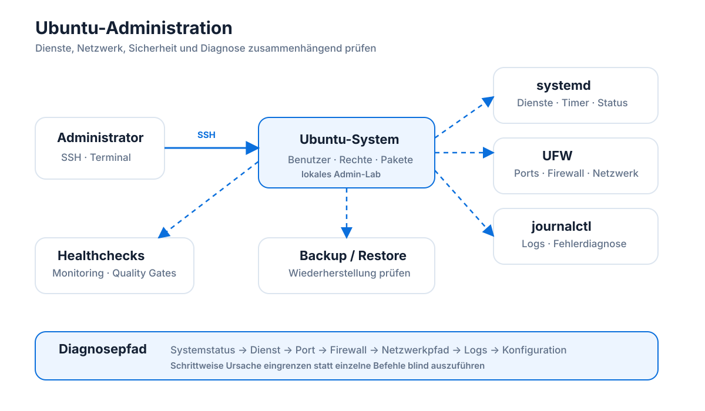

# Ubuntu Lab Baseline

## Zweck

Dieses Repository dokumentiert eine technische Linux-Admin-Baseline für ein Ubuntu-Lab-System.

Der Schwerpunkt liegt auf systematischer Administration, Healthchecks, Dienstdiagnose, kontrollierten Änderungen, Sicherheitsgrundlagen, Monitoring-Grundlagen, Backup-/Restore-Prüfungen und strukturierter Betriebsdokumentation.

## Einordnung und Lernziel

Dieses Repository dokumentiert ein Linux-Junior-Admin-Lab.

Der Fokus liegt auf dem Aufbau belastbarer Grundlagen für Administration, Fehlersuche und technische Bewertung. Viele Themen orientieren sich an produktionsnahen Anforderungen und an der Denkweise des BSI-IT-Grundschutzes, ohne eine vollständige BSI-konforme Umsetzung oder Zertifizierung abzubilden.

Ziel ist es, wiederholbare Diagnoseabläufe, nachvollziehbare Dokumentation und saubere Betriebsentscheidungen zu trainieren. Das Lab dient als Grundlage für weiterführende Lernprojekte in Richtung Windows Server, Active Directory, Microsoft 365, Cloud-/Hybrid-Infrastruktur und Architekturplanung.
## Systemkontext

- Betriebssystem: Ubuntu
- Einsatzkontext: lokales Linux-Lab
- Ziel: nachvollziehbare technische Basis für Administration, Diagnose und Betrieb
- Dokumentationsstil: technische Bewertung, Runbooks, Incident Cards, Statusberichte und Arbeitsaufträge

## Architektur im Überblick

Das Diagramm ordnet die einzelnen Übungen in einen gemeinsamen Administrationskontext ein: Der Zugriff erfolgt per SSH, anschließend werden Dienste, Ports, Firewall, Logs, Backup und Monitoring nicht isoliert, sondern als zusammenhängende Diagnose- und Betriebsbereiche betrachtet.

## Dokumentationsstruktur

| Pfad | Inhalt |
|---|---|
| `docs/operations/` | technische Bewertungen, Healthchecks, Baselines und Betriebseinordnungen |
| `docs/runbooks/` | wiederholbare Prüf- und Diagnoseabläufe |
| `docs/incident-cards/` | kompakte Störungskarten mit Symptom, Ursache, Bewertung und Maßnahmen |
| `docs/status/` | Abschlussstände und technische Statusberichte |
| `docs/work-orders/` | arbeitsauftragähnliche Aufgabenstellungen |
| `docs/lab-vs-production/` | Einordnung zwischen Lab-Umgebung und produktionsnaher Umgebung |
| `docs/roadmap/` | geplante Zusatzmodule |
| `scripts/` | Hilfsskripte für Prüfungen und Automatisierung |
| `configs/` | Konfigurationsbeispiele und technische Referenzen |
| `systemd/` | systemd-bezogene Einheiten und Tests |
| `troubleshooting/` | Diagnosematerial und Fehlersuche |

## Abgedeckte Themenbereiche

### Benutzer, Gruppen und Rechte

- Benutzer- und Gruppenprüfung
- sudo-Kontext
- Rechtebewertung
- Testbenutzer ohne sudo-Rechte

Relevante Dokumente:

- `docs/operations/benutzer-gruppen-sudo-einordnung.md`
- `docs/operations/lab20a-rechte-baseline-bewertung.md`
- `docs/operations/lab20b-dateirechte-diagnose-bewertung.md`

### systemd und Dienste

- Dienststatus
- Autostart
- Fehlerdiagnose
- Healthchecks
- Timer-Grundlagen

Relevante Dokumente:

- `docs/operations/lab04-systemd-fehlerdiagnose-demo-service.md`
- `docs/operations/lab05-systemd-timer-health-check.md`
- `docs/operations/systemd-ssh-health-check-summary.md`
- `docs/runbooks/lab21-dienstprobleme-schichtenmodell-runbook.md`

### Updates und Change-Planung

- apt-Update-Bewertung
- kontrollierter Update-Lauf
- Vorher-/Nachher-Vergleich
- Reboot- und Risikobewertung
- Backup-/Rollback-Referenz

Relevante Dokumente:

- `docs/operations/lab06-apt-update-bewertung.md`
- `docs/operations/lab06a-kontrollierter-update-change-plan.md`
- `docs/operations/lab06a-kontrollierter-update-lauf.md`
- `docs/operations/lab06-reboot-und-risiko-bewertung.md`

### Storage, Ressourcen und Logging

- Speicherplatzprüfung
- Ressourcenbewertung
- Loganalyse
- Logrotate-Grundlagen
- Dateisystem-Healthchecks

Relevante Dokumente:

- `docs/operations/lab07-storage-baseline.md`
- `docs/operations/lab08-logging-baseline.md`
- `docs/operations/lab09-resources-baseline.md`
- `docs/operations/lab16-log-und-dateisystem-healthcheck.md`
- `docs/runbooks/lab16-log-und-dateisystem-healthcheck-runbook.md`

### Netzwerk, SSH, Firewall und Ports

- SSH-Basisprüfung
- Portbindung
- UFW-Regeln
- Firewall-Aktivierung
- lokale vs. netzwerkfähige Dienste

Relevante Dokumente:

- `docs/operations/lab10-network-baseline.md`
- `docs/operations/lab11-firewall-port-baseline.md`
- `docs/operations/lab13-security-baseline.md`
- `docs/operations/lab13b-ufw-change-plan.md`
- `docs/operations/lab21b-ssh-cups-port-bindung-firewall-bewertung.md`

### Security-Grundlagen

- SSH-Härtung
- UFW
- Fail2ban
- auditd
- Paketintegrität
- Rechte- und Berechtigungskontext

Relevante Dokumente:

- `docs/operations/lab13a-ssh-haertung-change-plan.md`
- `docs/operations/lab14-fail2ban-change-plan.md`
- `docs/operations/lab15-auditd-installation-baseline.md`
- `docs/operations/lab15-auditd-paketintegritaet-diagnose.md`

### Backup und Restore

- Backup-Grundlagen
- Restore-Test
- kontrollierte Wiederherstellung
- Risiko- und Betriebsbewertung

Relevante Dokumente:

- `docs/operations/lab12-backup-restore-baseline.md`
- `docs/operations/lab12-kontrollierter-backup-restore-test.md`

### Monitoring und Quality Gates

- serviceorientiertes Monitoring
- Warning-/Critical-Bewertung
- Monitoring-Agent mit systemd
- Quality Gates
- Tabletop-Test

Relevante Dokumente:

- `docs/operations/lab17c-service-monitoring-matrix.md`
- `docs/runbooks/lab17-service-monitoring-healthcheck-runbook.md`
- `docs/runbooks/lab18-monitoring-agent-systemd-runbook.md`
- `docs/runbooks/lab19-ops-quality-gate-runbook.md`
- `docs/status/lab18j-monitoring-agent-abschlussstatus.md`
- `docs/status/lab19-ops-quality-gate-abschlussstatus.md`

### Incident Cards

Die Incident Cards dokumentieren kompakte Störungsbilder mit Ursache, Bewertung und Handlungsempfehlung.

Beispiele:

- `docs/incident-cards/lab16-dateisystem-varlog-laeuft-voll.md`
- `docs/incident-cards/lab17-service-monitoring-warning-critical.md`
- `docs/incident-cards/lab18-monitoring-agent-timer-stoerung.md`
- `docs/incident-cards/lab21-cups-lokal-statt-lan-erreichbar.md`
- `docs/incident-cards/lab24-cups-webinterface-nur-lokal-erreichbar.md`

## Zentrale Diagnose-Reihenfolge

Die technische Fehlersuche folgt einem betrieblichen Schichtenmodell:

1. Systemstatus
2. Dienststatus
3. Port und Bindung
4. Firewall
5. Client- und Netzwerkpfad
6. Logs
7. Konfiguration

Diese Reihenfolge ergänzt das klassische OSI-Modell.

Das OSI-Modell beschreibt Netzwerkkommunikation.

Das betriebliche Admin-Schichtenmodell beschreibt die praktische Reihenfolge der Fehlersuche.

Relevantes Dokument:

- `docs/operations/lab24b-osi-vs-admin-schichtenmodell.md`

## Abschlussstände

Wichtige Abschlussdokumente:

- `docs/status/lab21-service-troubleshooting-abschlussstatus.md`
- `docs/status/lab23-linux-admin-baseline-abschlussstatus.md`
- `docs/status/lab24-linux-junior-admin-abschlusspruefung-status.md`
- `docs/status/lab25-finaler-linux-junior-admin-kompetenzcheck.md`

## Lab-vs-Production-Einordnung

Dieses Repository dokumentiert eine Lab-Umgebung.

Die enthaltenen Verfahren sind technisch nachvollziehbar, ersetzen aber keine produktive Betriebsfreigabe, kein vollständiges Sicherheitskonzept und keine organisationsspezifischen Change-, Backup-, Monitoring- oder Incident-Response-Prozesse.

Relevantes Dokument:

- `docs/lab-vs-production/remote-linux-administration-lab-vs-produktion.md`

## Merksatz

Ein stabiler Betrieb entsteht nicht durch Einzelbefehle, sondern durch wiederholbare Prüfungen, klare Bewertung und dokumentierte Entscheidungen.
